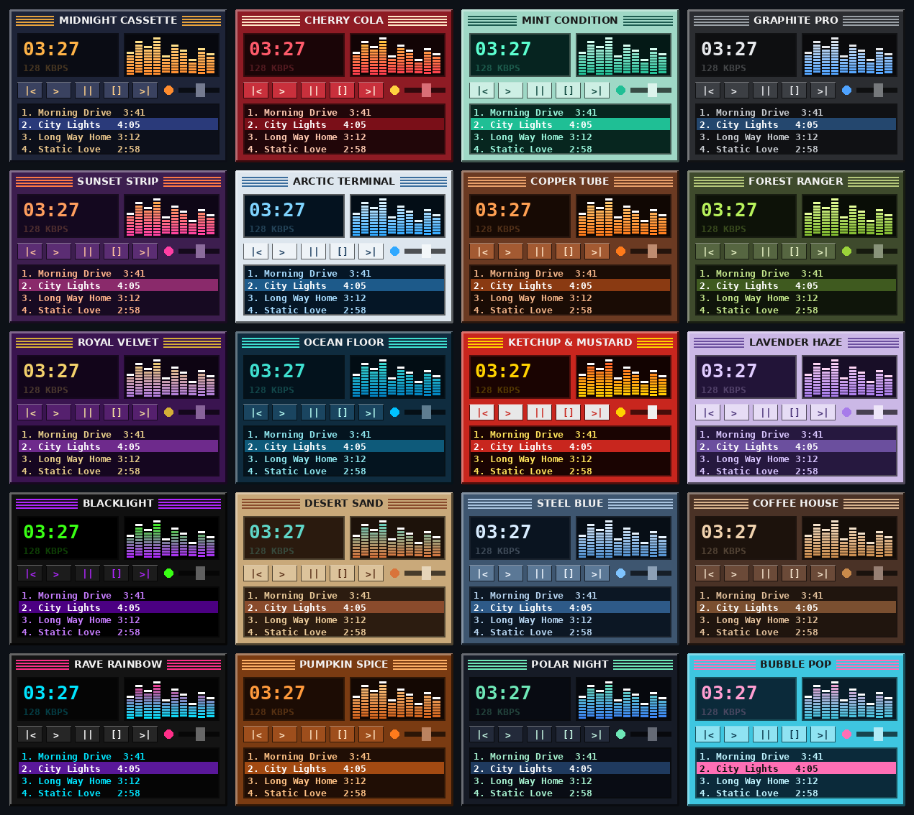

# Duo-Deck Skins

Free skins made by Duo-Deck users.

## Use a skin
1. Tap a .duodeck.json file below, then tap the download button.
2. In Duo-Deck, open Skin Studio > IMPORT SKIN FILE and pick the file.

## Share your skin
1. In Skin Studio, tap SAVE & SHARE.
2. On this site, open the Issues tab > New issue.
3. Name it "Skin: (your skin name)", drag your .duodeck.json file in, and submit.

## Starter pack

| Skin | Look |
|---|---|
| [Midnight Cassette](Midnight-Cassette.duodeck.json) | Deep navy tape deck with warm amber readouts |
| [Cherry Cola](Cherry-Cola.duodeck.json) | Glossy candy-red diner finish with cream text |
| [Mint Condition](Mint-Condition.duodeck.json) | Cool mint chassis with a dark teal screen |
| [Graphite Pro](Graphite-Pro.duodeck.json) | Studio-grade dark gray with clean white meters |
| [Sunset Strip](Sunset-Strip.duodeck.json) | Orange-to-purple dusk with hot pink highlights |
| [Arctic Terminal](Arctic-Terminal.duodeck.json) | Frosty white panels and a blue CRT glow |
| [Copper Tube](Copper-Tube.duodeck.json) | Warm copper amp with glowing tube orange |
| [Forest Ranger](Forest-Ranger.duodeck.json) | Olive drab with soft lime readouts |
| [Royal Velvet](Royal-Velvet.duodeck.json) | Deep purple velvet with gold trim |
| [Ocean Floor](Ocean-Floor.duodeck.json) | Dark sea blue with bioluminescent cyan |
| [Ketchup & Mustard](Ketchup-Mustard.duodeck.json) | Bold red and yellow stadium-snack look |
| [Lavender Haze](Lavender-Haze.duodeck.json) | Soft lilac pastels with a dreamy violet screen |
| [Blacklight](Blacklight.duodeck.json) | Pure black with UV purple and toxic green |
| [Desert Sand](Desert-Sand.duodeck.json) | Sandy tan with terracotta and turquoise |
| [Steel Blue](Steel-Blue.duodeck.json) | Brushed blue steel with icy white lights |
| [Coffee House](Coffee-House.duodeck.json) | Espresso browns with a latte-colored screen |
| [Rave Rainbow](Rave-Rainbow.duodeck.json) | Black body with a full rainbow spectrum |
| [Pumpkin Spice](Pumpkin-Spice.duodeck.json) | Burnt orange autumn with spiced brown |
| [Polar Night](Polar-Night.duodeck.json) | Near-black blue with soft aurora teal |
| [Bubble Pop](Bubble-Pop.duodeck.json) | Bright aqua and bubblegum toy-player fun |
